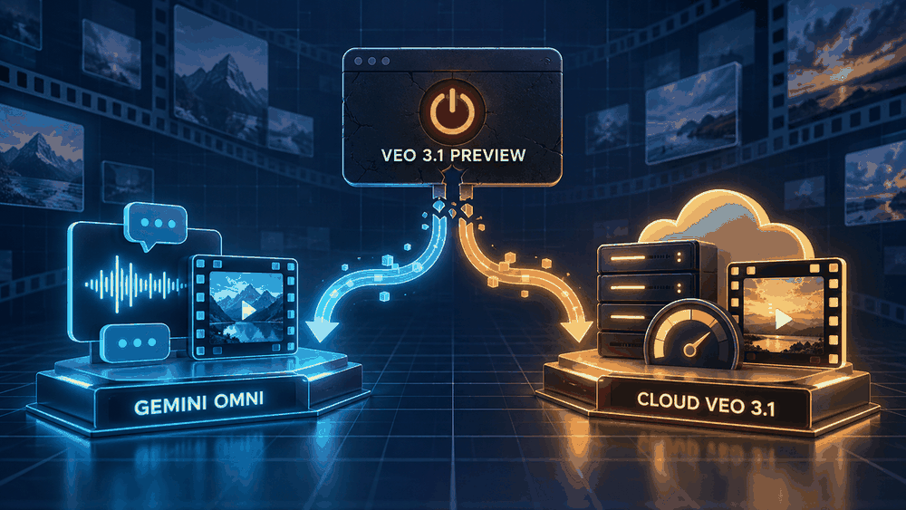
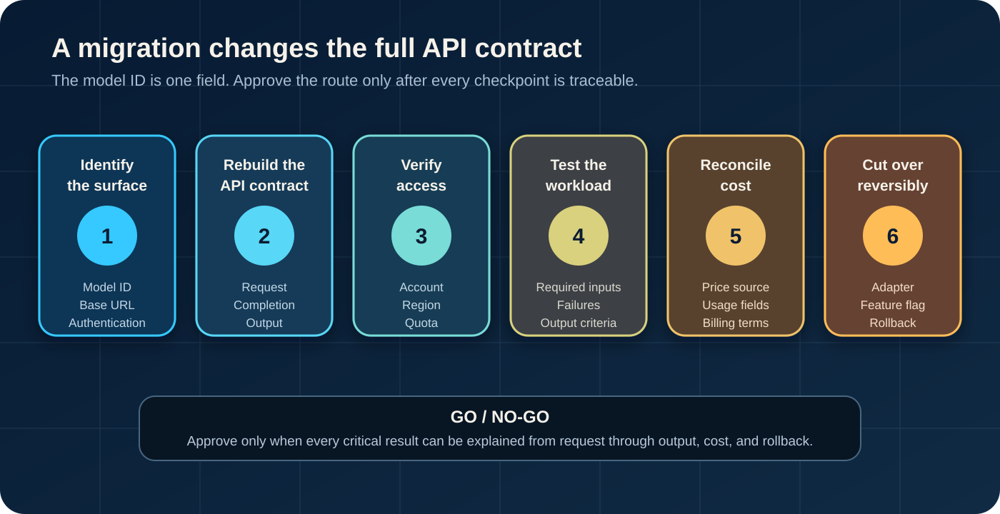

# Google Veo 3 API Status After the Veo 3.1 Preview Shutdown: Two Migration Paths

*After the Gemini API preview shutdown, teams can evaluate Gemini Omni or a Google Cloud Veo 3.1 route; each requires its own contract and access checks.*

Google shut down three Veo 3.1 Preview model IDs in the Gemini API on October 22, 2026: `veo-3.1-generate-preview`, `veo-3.1-fast-generate-preview`, and `veo-3.1-lite-generate-preview`. The [Gemini API deprecation record](https://ai.google.dev/gemini-api/docs/deprecations) confirms the date. Other Veo routes remain, but code that still calls any of those three IDs needs a migration.

Two official paths remain, and they solve different problems:

- **Stay on the Gemini API:** move to Gemini Omni Flash, `gemini-omni-1.1-flash`, and adopt the Interactions API.
- **Keep a Veo 3.1 contract on Google Cloud:** evaluate the GA `veo-3.1-generate-001` or `veo-3.1-fast-generate-001` models on Gemini Enterprise Agent Platform.

Migration changes more than the model string. A model ID only has meaning within its product surface. Authentication, endpoints, request shapes, operation lifecycles, outputs, quotas, pricing sources, and lifecycle rules can all change even when the business feature is still “generate a video.”

[Google's Veo 3.1 Gemini API guide](https://ai.google.dev/gemini-api/docs/veo?hl=en) contains the shutdown notice. Before changing code, record the model ID, base URL, authentication method, and request method used by the current integration. Those four fields tell you which migration you actually have.

No account, API key, request, generated video, quota, invoice, or production route was tested for this article. The conclusions below come from official documentation checked on November 2, 2026.

## First identify which API surface you used

“Veo 3.1” is not enough to identify an integration. Google used related model names on the Gemini API and Gemini Enterprise Agent Platform, but their lifecycle and access rules are separate. Treat the full model ID and product surface as one key.

| What you find in the integration | Product surface | Status checked November 2, 2026 | Official direction |
|---|---|---|---|
| `veo-3.1-generate-preview`, `veo-3.1-fast-generate-preview`, or `veo-3.1-lite-generate-preview` with the Gemini API | Gemini API | Shut down October 22, 2026 | Move to `gemini-omni-1.1-flash`, or evaluate Veo 3.1 GA on Gemini Enterprise Agent Platform |
| Any earlier Veo `*-preview` ID tied to a Google Cloud project and location | Gemini Enterprise Agent Platform | The Gemini API shutdown notice does not establish this route’s status | Look up the exact model’s cloud lifecycle notice before mapping it to a current `-001` model |
| `veo-3.1-generate-001` or `veo-3.1-fast-generate-001` in `us-central1` | Gemini Enterprise Agent Platform | Documented as GA; the model card listed retirement as November 17, 2026 or later | Do not migrate again from the name alone; confirm the current lifecycle notice and project quota first |
| `veo-3.1-lite-generate-001` | Gemini Enterprise Agent Platform | Documented as Preview | Apply preview-risk and feature-fit checks before relying on it |

The [current Gemini API video overview](https://ai.google.dev/gemini-api/docs/video) directs video-generation users to Gemini Omni Flash and says the Veo 3.1 Preview in that API has shut down. Meanwhile, Google’s cloud model card still documents Veo 3.1 variants. The pages describe different products, so their status statements do not conflict.

Audit four fields in code and configuration:

1. **Model ID:** preserve the full suffix, including `preview` or `001`.
2. **Base URL or SDK client mode:** identify whether the call targets the Gemini API or the Google Cloud platform.
3. **Authentication and project context:** note an API-key flow versus a Cloud project, location, and platform setup.
4. **Request method:** look for the former Veo generate-video/long-running-operation flow, the Interactions API, or a cloud prediction flow.

Also search logs, feature flags, job workers, retry code, and download handlers. Updating the visible application configuration while a queue consumer retains the old ID creates a partial migration: foreground requests move, but background jobs keep failing.

## Path 1: stay on the Gemini API with Gemini Omni Flash

Choose this path first when the application should remain on the Gemini API and the team can change its video adapter. The current model ID is `gemini-omni-1.1-flash`, and Google's [Gemini Omni Flash guide](https://ai.google.dev/gemini-api/docs/omni) uses the Interactions API rather than the former Veo generate-video operation.

That distinction changes real code. The older Veo examples started a long-running generation, polled the operation until completion, and then downloaded the generated file. Omni examples create an interaction and expose video output through the interaction response. Conversational editing can also continue from a previous interaction. A retry loop, job-state model, parser, download path, or observability dashboard built around Veo operations will not automatically understand that contract.

Keep this route in the shortlist when all of these conditions hold:

- the Gemini API is the required product surface;
- an API-key-based Gemini integration is already acceptable to the organization;
- conversational generation or editing fits the product;
- the team can rewrite response parsing and state handling; and
- a workload regression suite confirms the required inputs, duration, resolution, audio, safety behavior, and output handling.

Do not select Omni solely because Google names it as the Gemini API replacement. Keep the cloud Veo route in the evaluation if the application depends on a Veo-specific control, a particular operation pattern, or Cloud governance and quota management.

Documentation can describe capabilities, but it cannot prove equivalence for your prompts. Build fixtures from the real request categories that matter to the product, including text-to-video, image-to-video, extension, frame controls, reference assets, and failure cases. Record the requested settings and the returned metadata with each result. Quality, latency, policy outcomes, and unit cost should remain unknown until that workload is tested under the account and route that will actually run in production.

## Path 2: keep Veo 3.1 through Google's enterprise cloud platform

Choose this path when preserving a Veo 3.1 model contract and using Google Cloud controls matters more than staying on the Gemini API. Google's [Veo 3.1 model card](https://docs.cloud.google.com/gemini-enterprise-agent-platform/models/veo/3-1-generate) lists `veo-3.1-generate-001` and `veo-3.1-fast-generate-001` as GA. It lists `veo-3.1-lite-generate-001` separately as Preview.

The same model card makes access conditions part of the decision:

- the documented region is `us-central1`;
- fixed quota and Provisioned Throughput are listed as supported;
- pay-as-you-go and batch inference are listed as not supported for the documented Veo variants; and
- the two GA entries list a retirement date of November 17, 2026 or later.

Together, those conditions determine whether the route can be deployed and kept in service. A GA label does not guarantee that every project can call the model, that the region fits a data or architecture requirement, or that the remaining lifecycle suits a new migration. Because the checked date is November 2, the listed retirement floor is close enough that a fresh lifecycle check should be a release gate.

The [Agent Platform quota documentation](https://docs.cloud.google.com/gemini-enterprise-agent-platform/models/quotas) says quotas generally apply at the Google Cloud project level. It also identifies Veo's quota metric as long-running online prediction requests per base model and instructs teams to enable the platform API before managing the quota. Check the real project rather than inferring entitlement from the public model card.

Keep this route in the shortlist when the application requires documented Veo controls, the project can use `us-central1`, the organization needs the listed Cloud controls, and both quota and lifecycle checks pass. Reject it when the needed quota is unavailable, the region conflicts with requirements, the lifecycle window fails the release policy, or the team cannot operate the Cloud prediction contract.

Before committing, capture the current model card, quota screen, price source, and applicable account terms. Public documentation establishes what Google lists; it does not prove your project's access.

## Why this is a contract migration, not a model rename

The prompt is only one layer of a production video pipeline. A route can accept the same sentence yet require a different identity, job lifecycle, output parser, storage path, capacity plan, and cost model.

| Contract layer | Former Gemini API Veo Preview | Gemini API with Omni Flash | Gemini Enterprise Agent Platform with Veo 3.1 |
|---|---|---|---|
| Model | `veo-3.1-*-generate-preview` | `gemini-omni-1.1-flash` | `veo-3.1-generate-001` or `veo-3.1-fast-generate-001` |
| Product surface | Gemini API | Gemini API | Gemini Enterprise Agent Platform |
| Access context | Gemini API key shown in official examples | Gemini API key shown in official examples | Cloud project, location, enabled platform API, and project quota |
| Request pattern | Generate video or `predictLongRunning` | Create an interaction | Veo prediction flow on the cloud platform |
| Completion/output | Poll an operation, then download the generated video | Read video output from the interaction response; editing can use prior interaction state | Handle the platform's long-running prediction and output contract |
| Capacity evidence | Former Gemini API limits | Current Gemini API limits and account tier | Project quota or supported provisioned capacity |
| Lifecycle source | Gemini API deprecation notice | Gemini API model and changelog pages | Cloud model card and lifecycle notices |
| Pricing source | Historical Gemini API route pricing | Current Gemini API pricing | [Current Agent Platform pricing](https://cloud.google.com/model-garden/pricing) and account terms |

Use this map to start the audit. The current route guide should control implementation because Google can change client libraries and documentation.

The operational consequences are wider than the table. Timeouts and retries must match the new completion model. Idempotency and job deduplication must prevent a retry from creating unwanted generations. Output storage must handle the response form, file lifetime, and download behavior. Monitoring must distinguish policy filtering, quota rejection, invalid inputs, transient service errors, and successful generation. Cost controls must use the destination route's billing unit and successful-generation rules rather than a historical per-clip assumption.

A console or quickstart success covers only part of the migration. Approve the complete request-to-output path under the identity, capacity, and billing arrangement that production will use.

*Treat the destination as a new operating contract. The model ID is only the first field to verify.*

## Use a migration checklist that can produce a go/no-go decision

A useful checklist ends in evidence, not a completed-looking set of boxes. Define the required result for each step before a cutover.

1. **Freeze the old contract description.** Record model ID, provider surface, endpoint, authentication, request fields, duration and resolution controls, operation polling, output retrieval, retry behavior, quota, price source, and storage. The old endpoint may no longer run, but its code and historical logs still describe what the product depended on.

2. **Build a capability matrix from real workload requirements.** Mark each feature required, optional, or unused. Include text and image inputs, reference assets, first/last frames, extension, audio, aspect ratio, duration, resolution, number of outputs, content credentials, and policy behavior. A replacement does not need every feature; it needs every feature your product actually uses.

3. **Verify access before estimating delivery.** For Gemini API, confirm the account's current model access and limits. For the cloud route, confirm project, region, enabled API, quota, lifecycle, and applicable consumption option. For any third-party route, confirm the provider's exact upstream model ID and interface. A catalog entry is not proof of a successful production call.

4. **Run representative and failure-path tests.** Use prompts and inputs from the product's real workload classes, with approved test data. Evaluate outputs against predefined criteria rather than a few attractive examples. Exercise invalid inputs, policy filtering, quota exhaustion, timeouts, retries, duplicate submission, missing output, and download failures. Record latency and error distributions instead of a single result.

5. **Rebuild the cost model.** Use the destination's current price page and the measured workload mix. Include unsuccessful or filtered-request rules, output resolution, audio, storage, network transfer, quota or provisioned-capacity commitments, taxes, and account-specific terms where they apply. Do not carry the former route's unit price into the new one.

6. **Make the route observable.** Log the provider surface, model ID, request ID, operation or interaction ID, requested settings, completion state, error class, output location, and billable usage fields that the route returns. Keep secrets and sensitive prompts out of logs.

7. **Cut over reversibly.** Put the new route behind an adapter and feature flag, start with controlled traffic, compare acceptance and cost evidence, and retain a rollback path that does not depend on the already-shut preview endpoint. Approve the migration only when the new route satisfies the product's quality, policy, reliability, cost, and operational thresholds.

## Where a unified API route fits—and what still needs verification

A unified API can reduce provider-specific adapter work, but it does not remove route validation. The unified provider still has its own model IDs, request schema, output handling, limits, pricing, account rules, lifecycle process, and availability evidence.
Moduck publishes this article. Its confirmed product materials cover model discovery, selection, pricing information, and API access, but they do not establish that Veo 3.1 or Gemini Omni Flash is currently available through Moduck—or that its interface matches either Google route.
If Moduck remains on your shortlist, compare its [current model documentation](https://docs.moduck.ai/) against the same model ID, interface, pricing, eligibility, and availability checks used for Google. If the required model or contract cannot be verified, keep the first-party route in the lead.

## Choose the route you can validate and reverse

Choose Gemini Omni Flash when remaining on the Gemini API is the priority, the Interactions API fits the product, and workload tests approve the change in output and operations. Choose Veo 3.1 on Gemini Enterprise Agent Platform when a documented Veo contract or Cloud control is required, and only after current region, quota, consumption option, pricing, and lifecycle checks pass.

Neither choice is permanent. Re-run the comparison when Google changes a model ID, lifecycle date, region, quota rule, API contract, price, or access term; when the workload adds a new input or video control; or when measured quality, policy outcomes, latency, errors, or unit cost cross an acceptance threshold.

Start with the current integration inventory. Put one candidate behind a reversible adapter, test the complete request-to-output path, and keep the migration unapproved until every critical result can be explained from request through output, quota, cost, and rollback.

*Research scope: English-language general search results and first-party documentation were sampled on November 2, 2026. The sample was not localized to a country, city, device, account, or personalized result set and does not represent every user's results. Documentation and policies can change. No account, API key, request, generated video, quota change, invoice, payment, performance result, availability claim, or production route was tested.*
